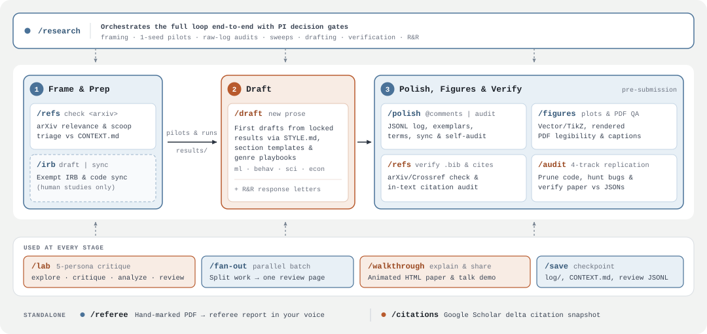

# Lab of Agents

A suite of [Agent Skills](https://agentskills.io) for end-to-end academic research—combining a 5-persona AI research group (`/lab`) with specialized skills for drafting, polishing, publication figures, interactive paper explainers, reference verification, code/replication audits, IRB packets, and refereeing.



## Install

Install once at user level so every skill works in any project. In Claude Code (or any Agent Skills client):

```text
Install the agent lab skills from https://github.com/harangju/agent-lab/ into ~/.agents/skills and ~/.claude/skills
```

Or clone and symlink to stay updated with `git pull` (use `cp -R` instead if you want private local edits):

```bash
git clone https://github.com/harangju/agent-lab.git ~/agent-lab
mkdir -p ~/.agents/skills ~/.claude/skills
for s in lab draft polish figures walkthrough refs audit save fan-out referee research irb citations; do
  ln -s ~/agent-lab/.agents/skills/$s ~/.agents/skills/$s
  ln -s ~/agent-lab/.agents/skills/$s ~/.claude/skills/$s
done
```

**Optional paper search MCP:** Connect [Consensus](https://consensus.app) or add [Semantic Scholar](https://www.semanticscholar.org/product/api) (`claude mcp add --transport stdio --scope user semantic-scholar -- uvx semantic-scholar-fastmcp`).

## Commands

| Command | What it does |
| --- | --- |
| `/research [question \| resume]` | Orchestrate the full 6-stage loop (framing, toy proof, 1-seed pilot, sweeps, drafting, verification, R&R) with PI decision gates. |
| `/lab [task]` | Convene 5 parallel personas to explore a topic, critique a design, analyze results, review a draft, or triage referee feedback. |
| `/draft [section] [ask]` | Write clean first drafts from notes or locked results using `STYLE.md`, section templates, venue exemplars, and genre playbooks (`ml`, `behavioral`, `general-science`, `management-econ`). |
| `/polish [mode \| file]` | Revise existing LaTeX/Markdown manuscripts: resolve `% @comment` / `<!-- @comment -->` notes into `notes/review_comments.jsonl`, audit against venue exemplars and standard field terminology, propagate renames, and run a fresh PI-eye self-audit. |
| `/figures [figure \| script]` | Design and regenerate publication figures (Matplotlib SVG/PDF, TikZ), inspect rendered PDF pages for print-scale legibility, and sync titles and captions. |
| `/walkthrough [paper]` | Build a self-contained, 60–120fps 2D animated HTML paper explainer (`notes/walkthrough.html`) with headless-Chrome visual QA. |
| `/refs [verify \| check]` | Verify every `.bib` entry and in-text citation against arXiv, Crossref, and OpenAlex, or run a fast arXiv relevance/scoop check against `CONTEXT.md`. |
| `/audit [scope]` | Run a 4-track parallel pre-submission audit: prune dead scripts and cluster launchers, hunt silent code/split bugs, and verify offline paper-vs-JSON replication. |
| `/fan-out [batch]` | Split independent work across parallel workers, integrate and verify where pieces meet, and hand back one visual review page. |
| `/save [topic]` | Append a session log to `log/`, compact `CONTEXT.md`, and mine `log/` + `notes/review_comments.jsonl` to propose standing rules. |
| `/irb [draft \| sync \| revise \| stamp \| closeout]` | Draft, sync, and audit Exempt online human-subjects IRB packets (`.docx` attachments + live experiment code). |
| `/referee [pdf]` | Transcribe hand-marked PDF margins into `comments.md` and draft a terse referee report in your voice with fresh-context checkers. |
| `/citations [scholar id]` | Delta-sync a local Google Scholar citation snapshot (`citations.jsonl`) fetching only changed papers. |

## `/lab` Personas

Lead runs in your main session and coordinates five parallel subagents; only high-stakes or irreversible cruxes escalate to you.

| Persona | Owns | Core question |
| --- | --- | --- |
| **Lead** | Presentation | Works disagreements down to their crux and recommends a call |
| **Skeptic** | Novelty | "Has this been done? What's actually new?" |
| **Methodologist** | Rigor | "Is this sound? Does the code/data back it up?" |
| **Visionary** | Impact | "So what? Who cares? Think bigger." |
| **Newcomer** | Clarity | "You lost me. Explain it simply." |
| **Connector** | Integration | "How does this link to adjacent fields?" |

## Project State & Private Config

Skills hold stable craft rules under `.agents/skills/`; each project only stores its own living state:

- **`CONTEXT.md` & `log/`** — Compacted project state and append-only session logs maintained by `/save`.
- **`notes/STYLE.md` & `notes/review_comments.jsonl`** — Project terminology overrides and logged editorial edits mined by `/save` for recurring standing rules.
- **`~/.config/agent-lab/`** — Local untracked files for private pointers (`exemplars.json`, `irb-profile.md`, `citations-profile.json`) so personal details stay out of this public repo.

## License

MIT
